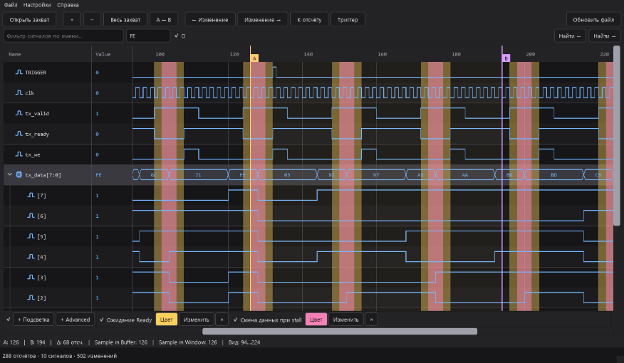
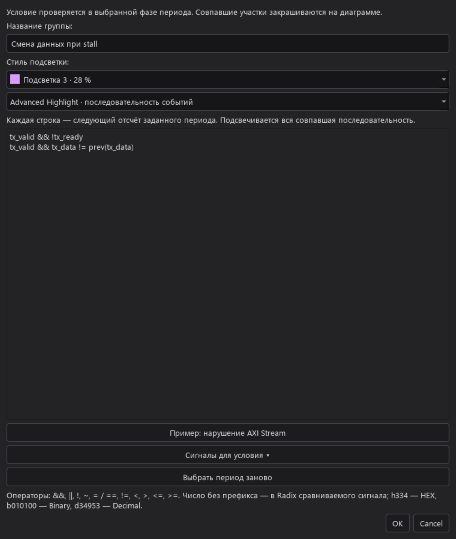
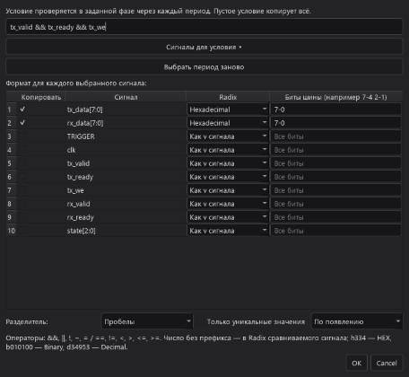

# RTLForge — Waveform Reader

Настольный просмотрщик CSV-захватов Vivado ILA и симуляций Questa/ModelSim
(`.wlf`, `.vcd`) на Python и PySide6. Открывает данные локально и только для чтения. Шины можно раскрывать
на отдельные биты; диаграмму — прокручивать, масштабировать, искать переходы
и значения.
Однобитные переменные VCD вида `rx_data[8]` … `rx_data[0]` автоматически
собираются в раскрываемую шину `rx_data[8:0]`, если индексы идут подряд.



*Искусственный захват: раскрытая шина `tx_data`, маркеры A/B и подсветка ожидания
`Ready` и смены данных при остановке передачи.*



*Advanced Highlight: два последовательных события с обращением к предыдущему
значению через `prev(tx_data)`.*



*Copy Values: условие выборки, отдельный Radix и диапазон битов для каждого
копируемого сигнала.*

## Быстрый запуск на Windows

1. Установите Python 3.10 или новее.
2. Запустите `setup.bat` в папке проекта. Он создаст `.venv` и установит
   зависимости из `requirements.txt`.
3. Запустите `start.bat` и откройте CSV, VCD или WLF через **Ctrl+O** или
   перетащите файл в окно. Файл можно перетащить и на `start.bat`.

Для открытия WLF нужен установленный Questa/ModelSim с утилитой `wlf2vcd`.
Укажите путь к ней в **Настройки → Параметры… → Источники** либо добавьте её
в `PATH` (также поддерживается переменная `WLF2VCD`). Приложение временно
конвертирует WLF в VCD и удаляет промежуточный файл после загрузки.
Если утилиты нет, экспортируйте VCD в симуляторе и откройте его напрямую.
Сложные типы, которые `wlf2vcd` не переводит в VCD, не появятся в просмотрщике.
Если WLF записан не до конца, приложение автоматически вызывает `wlfrecover`
на **временной копии**, затем повторяет конвертацию. Исходный WLF не меняется.
Команда **Файл → Сохранить WLF как VCD…** создаёт постоянный VCD: после этого
его можно открывать без Questa/ModelSim.

Если в корне проекта лежит личный `waveform.csv`, приложение откроет его при
старте. Этот файл исключён из Git. Для запуска из терминала:

```powershell
.\.venv\Scripts\python.exe -m ila_viewer "C:\path\to\capture.csv"
```

Для работы с кодом:

```powershell
.\.venv\Scripts\python.exe -m unittest -v tests.test_waveform tests.test_extensions
.\.venv\Scripts\python.exe -m scripts.benchmark_waveform
```

Тесты используют искусственный захват из `tests/fixtures/`; личные данные
в репозиторий не входят. Иллюстрации выше созданы из отдельного искусственного
CSV командой `python -m scripts.generate_readme_images`.

## Возможности

- Шины, отдельные биты, группы, разделители, несколько тем и форматов Radix.
- Фильтр имён сохраняет состояние раскрытия шин; выбор сигналов доступен в
  колонках Name/Value и непосредственно на диаграмме через Ctrl+щелчок.
- Прокрутка и масштабирование больших захватов с дисковыми индексами переходов.
- VCD/WLF: ось X пропорциональна времени симуляции; один отсчёт соответствует
  временной отметке с событиями. Период выборки в Copy Values и подсветках
  задаётся по индексам событий, а не по единицам времени симуляции.
- Маркеры A/B, поиск значения и переход к изменениям сигнала.
- Именованные маркеры (Ctrl+M в позиции A, Alt+←/→ — переход, список в
  «Навигация → Маркеры…») хранятся только для текущего захвата.
- Для однобитного сигнала между A и B — число фронтов и оценка периода/частоты;
  для VCD/WLF — в реальных единицах времени симуляции.
- Возврат к последней папке при открытии CSV и кнопка «Обновить CSV» для повторной загрузки файла.
- При обновлении CSV сохраняются цвета совпавших сигналов и пересчитываются
  подсветки, условия которых остаются действительными.
- Общий или раздельный цвет и заливка шин/однобитных сигналов с настройками для каждой темы.
- Горизонтальная панель групп подсветки по логическому условию; у каждой группы
  свой цвет и прозрачность. Общая галочка скрывает все группы с сохранением
  индивидуальной видимости. Без B подсветка охватывает весь захват.
- Advanced Highlight подсвечивает последовательность событий на соседних отсчётах
  настроенного периода; `prev(tx_data)` обращается к предыдущему отсчёту.
  Сравнения используют Radix сигнала, а `h`, `b`, `d` задают основание числа явно.
- Копирование выбранных сигналов и битов с отдельным Radix и диапазонами битов
  для каждого сигнала, добавлением сигналов прямо в редакторе, выбором
  уникальных значений и условием вида
  `tx_ready && tx_we && tx_data == FE`. Период выборки задаётся двумя точками
  на диаграмме во временном режиме и учитывает фазу от первой точки;
  левая граница включается, правая исключается независимо от порядка A/B;
  без B копируется весь захват.
- Параметры интерфейса сохраняются между запусками; содержимое CSV и
  индивидуальное оформление сигналов не изменяются.

Подробные действия описаны в [руководстве пользователя](docs/USER_GUIDE.md).
Устройство кода и точки расширения — в [документе об архитектуре](docs/ARCHITECTURE.md).

## Структура проекта

| Путь | Назначение |
|---|---|
| `ila_viewer/` | Код приложения: чтение CSV, модель, интерфейс и экспорт |
| `ila_viewer/__main__.py` | Точка запуска через `python -m ila_viewer` |
| `tests/` | Тесты и искусственный CSV-захват |
| `docs/` | Руководство пользователя и архитектура |
| `scripts/generate_readme_images.py` | Создание иллюстраций документации из искусственных данных |
| `scripts/benchmark_waveform.py` | Проверка на миллионе искусственных отсчётов |
| `setup.bat`, `start.bat` | Установка зависимостей и запуск на Windows |

## Лицензия

Copyright © 2026 Вячеслав Рудаков. Проект распространяется по
[Apache License 2.0](LICENSE); сведения об авторстве — в [NOTICE](NOTICE).
Зависимости PySide6 и NumPy устанавливаются отдельно и имеют собственные лицензии.
